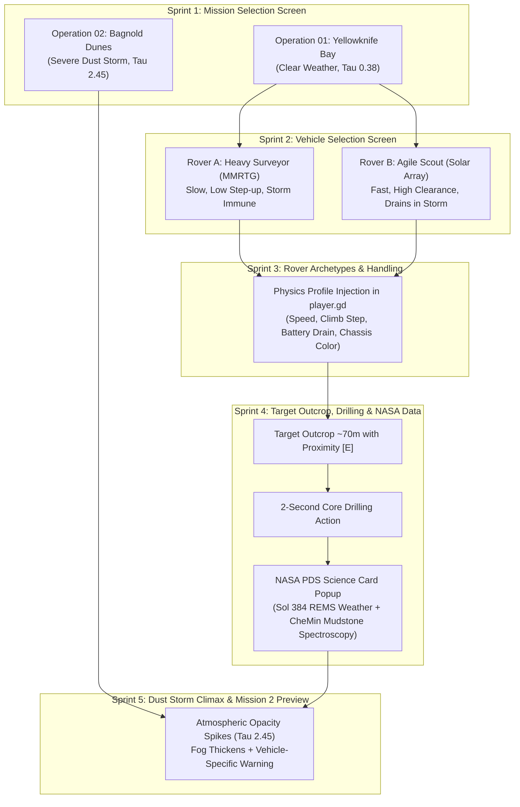

# Project Mission & Architecture Plan: NASA Gale Crater Rover Operations

> **Data Provenance & Source Credit:** 
> - Topography: Gale Crater HRSC Digital Elevation Model (ESA/DLR/FU Berlin).
> - Surface Telemetry: NASA Curiosity Rover Environmental Monitoring Station (REMS).
> - Mineralogy: NASA Mars Science Laboratory CheMin / APXS Spectral Catalog (PDS).

---

## High-Level Architecture Overview

---

## Sprint Breakdown

### Sprint 1: Mission Dispatch UI (`MissionSelectModal`)
* **Goal:** Present the player with the two mission choices before deploying.
* **Deliverables:**
  - `scenes/mission_select.tscn` / integrated modal in HUD.
  - **Operation 01 (Yellowknife Bay Mudstone)**:
    - Target: Outcrop ~70 m.
    - Weather: Sol 384 Clear Sky ($\tau = 0.38$, $-14^\circ\text{C}$).
    - Status: Primary Objective (Playable). Clicking advances to Sprint 2 (Vehicle Select).
  - **Operation 02 (Bagnold Dunes Basalt)**:
    - Target: Dune Field ~350 m.
    - Weather: Sol 2097 Severe Dust Event ($\tau = 2.45$, $-26^\circ\text{C}$).
    - Status: High-Risk Showcase Teaser. Clicking triggers the storm atmosphere directly as a live preview.

---

### Sprint 2: Vehicle Selection UI (`VehicleSelectModal`)
* **Goal:** Allow the player to choose their rover archetype based on mission trade-offs.
* **Deliverables:**
  - Vehicle cards showing authentic technical specs:
    - **Heavy Surveyor (MMRTG Nuclear)**:
      - Power: Plutonium-238 MMRTG (Continuous $125\text{W}$).
      - Speed: $6.0\text{ m/s}$ (Slow & Heavy).
      - Step Clearance: $0.25\text{ m}$ (Struggles with rocks).
      - Weather Resilience: $100\%$ immune to dust blockage.
    - **Agile Scout (Solar Array)**:
      - Power: Triple-Junction Solar Panels.
      - Speed: $11.0\text{ m/s}$ (Fast & Nimble).
      - Step Clearance: $0.42\text{ m}$ (Hops small surface rocks).
      - Weather Resilience: Vulnerable to dust storms ($3\times$ battery drain when sun is blocked).
  - Back button (`< Return to Missions`).
  - Deploy button (`LAUNCH ROVER`).

---

### Sprint 3: Rover Archetype Profile Switcher (`scripts/player.gd`)
* **Goal:** Dynamically apply the chosen vehicle's mechanical and visual parameters at spawn.
* **Deliverables:**
  - Add method `apply_rover_profile(profile_type: String)` in `player.gd`:
    - Heavy: `max_forward_speed = 6.0`, `max_climb_height = 0.25`, `battery_drain_rate = 0.4`, `turn_speed = 1.1`, chassis darker industrial tint.
    - Agile: `max_forward_speed = 11.0`, `max_climb_height = 0.42`, `battery_drain_rate = 0.5`, `turn_speed = 1.6`, chassis gold solar wing tint.
  - Store active profile type on the rover for storm reaction calculations.

---

### Sprint 4: Target Outcrop, Drilling & Real NASA Scientific Dataset
* **Goal:** Implement the sampling interaction and authentic NASA science readout.
* **Deliverables:**
  - **NASA Gale Crater Telemetry Data file (`assets/data/nasa_gale_science.json`)**:
    - **Sol 384 Weather (REMS)**: Air Temp $-73^\circ\text{C} / -14^\circ\text{C}$, Pressure $812\text{ Pa}$, $\tau = 0.38$.
    - **Sol 2097 Dust Storm Weather (REMS)**: $\tau = 2.45$, high scattering, $-26^\circ\text{C}$.
    - **Yellowknife Bay Sample (*John Klein* Core - CheMin / APXS)**:
      - Smectite Clay ($22\%$), Plagioclase ($38\%$), Fe-Forsterite Olivine ($18\%$), Calcium Sulfate veins / Bassanite ($4\%$).
      - Geochemical Conclusion: Ancient freshwater lacustrine environment with neutral pH.
  - **Outcrop Landmark**:
    - Placed ~70 m from spawn with a visible waypoint beacon.
    - `Area3D` proximity detector that reveals: `[E] EXTRACT CORE SAMPLE`.
  - **Sampling Action**:
    - Pressing `E` plays a 2-second drill vibration/progress gauge.
    - Pops up the **NASA CheMin Planetary Data System Card** detailing the rock core composition and habitability findings.

---

### Sprint 5: Dust Storm Climax, Vehicle Reactions & Verification
* **Goal:** Trigger the Mission 2 showcase dust storm and test both vehicle responses.
* **Deliverables:**
  - Upon closing the sample card, the incoming storm hits:
    - `dust_storm.gd` transitions fog density to $0.035$ and camera distance to $60\text{ m}$.
    - If playing as **Agile Scout**: HUD flashes `⚠️ SOLAR ARRAY OCCLUDED: Tau 2.45 - Battery Drain 3x Active!`.
    - If playing as **Heavy Surveyor**: HUD displays `🛡️ MMRTG STATUS: Nominal - Power Generation Independent of Dust.`.
  - End-to-end verification in Godot to ensure smooth performance on WebGL/compatibility renderer.
